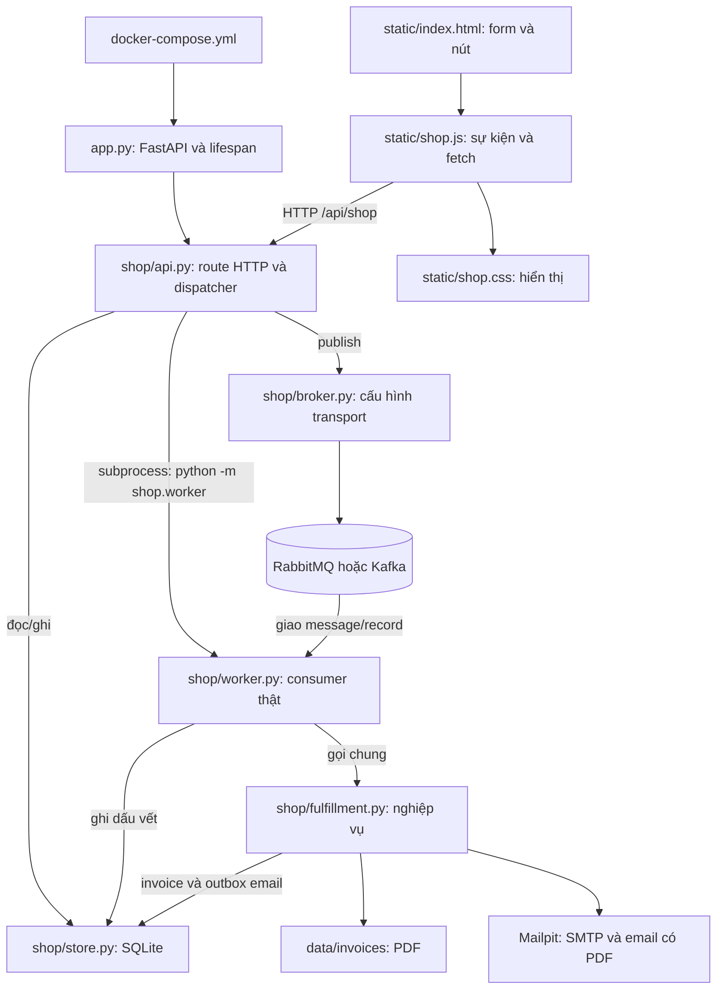
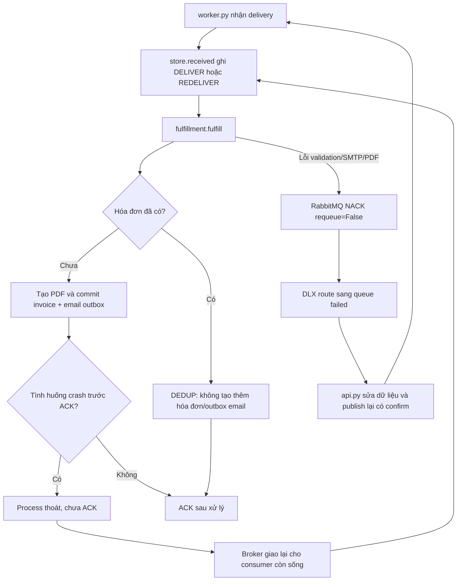
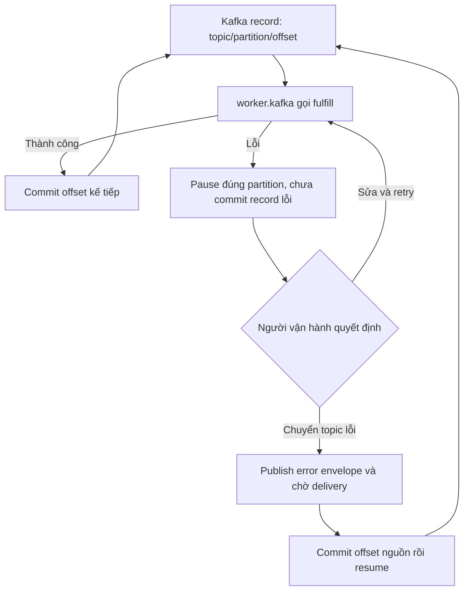

# Bản đồ dự án và luồng điều khiển

Bản cửa hàng được sắp xếp ngày 31/10/2026. Chỉ còn một ứng dụng; lab v3 và tài liệu riêng của lab đã bỏ khỏi mã nguồn hiện hành. Dữ liệu cũ trong `data/` không bị xóa. File đã bỏ vẫn có thể xem trong lịch sử Git.

## 1. Đọc thư mục theo thứ tự này

```text
demo_soa_rabbitmq/
  app.py                 Mở web, gắn API và frontend
  shop/
    __init__.py          Đánh dấu package Python
    api.py               Nhận HTTP; dispatcher; nút điều khiển worker
    store.py             Catalogue, SQLite, transaction và trạng thái
    broker.py            Kết nối/topology/publish RabbitMQ và Kafka
    worker.py            Consumer, ACK/NACK, offset và xử lý lỗi
    fulfillment.py       Tạo PDF và gửi SMTP
  static/
    index.html           Bốn tab giao diện và các nút/form
    shop.js              Sự kiện nút, gọi API, cập nhật màn hình
    shop.css             Bố cục, màu sắc, responsive
    products/            Ảnh sản phẩm
    fonts/               Font PDF tiếng Việt và giấy phép
  docs/                  Sổ tay, sơ đồ, kịch bản, nguồn học, kết quả test
  tests/                 Unit, integration, nghiệp vụ, trình duyệt
  tools/build_guide.py    Ghép tài liệu thành PDF để in
  Dockerfile             Image Python của web/worker
  docker-compose.yml     Web + RabbitMQ + Mailpit + Kafka tùy chọn
  requirements.txt       Thư viện Python cố định phiên bản
  .env.example           Mẫu cấu hình cổng, không phải bí mật thật
  start-demo.cmd         Khởi chạy Compose trên Windows
  data/                  Sinh khi chạy; không đưa lên GitHub
```

`data/`, `output/` và log là dữ liệu phát sinh, không phải module phải học. Thư mục `.git/` phục vụ quản lý phiên bản. Không xóa DB hoặc volume khi cần giữ đơn hàng. `.venv/` và `.vscode/` là môi trường/cấu hình cá nhân, không được đưa vào bản clone.

## 2. Quan hệ file: ai gọi ai?



Mũi tên HTTP và message không phải Python import. API không gọi trực tiếp hàm consumer để xử lý đơn; worker nhận việc từ broker. `store.py` được nhiều process dùng qua các kết nối SQLite riêng, không phải chia sẻ một biến Python trong bộ nhớ.

## 3. Một đơn hàng đi từ lúc bấm đặt đến lúc nhận email

```mermaid
sequenceDiagram
    participant UI as static/shop.js
    participant API as shop/api.py
    participant DB as shop/store.py - SQLite
    participant Bus as shop/broker.py - RabbitMQ
    participant W as shop/worker.py
    participant F as shop/fulfillment.py
    participant Mail as Mailpit
    UI->>API: POST checkout + idempotency_key
    API->>DB: create_order: đơn + task invoice + outbox
    DB-->>API: commit cùng transaction
    API-->>UI: HTTP 202 + order_id
    Note over API,DB: Dispatcher chạy nền; không phụ thuộc trình duyệt mở
    API->>DB: pending_outbox
    API->>Bus: publish invoice, chờ confirm
    Bus-->>API: broker confirm
    API->>DB: published
    Bus->>W: delivery invoice
    W->>F: fulfill role invoice
    F->>F: tạo file PDF
    F->>DB: commit invoice + outbox email
    W->>Bus: basic_ack delivery hóa đơn
    API->>Bus: publish email từ outbox
    Bus->>W: delivery email cho consumer vai trò email
    W->>F: fulfill role email
    F->>Mail: SMTP có PDF đính kèm
    Mail-->>F: SMTP accepted
    F->>DB: record_sent
    W->>Bus: basic_ack delivery email
    UI->>API: GET state theo chu kỳ
    API-->>UI: trạng thái, worker, event, số đếm broker
```

Đây là thứ tự phụ thuộc nghiệp vụ, không bảo đảm mọi dòng log toàn hệ thống xuất hiện y hệt thứ tự vẽ: dispatcher/consumer chạy đồng thời. HTTP 202 dựa trên commit DB; không đợi PDF và SMTP. ACK của consumer khác publisher confirm.

## 4. Worker sập và email lỗi rẽ nhánh ở đâu?



DLQ không tự sửa dữ liệu. Nhánh email kiểm tra sổ gửi trước SMTP nhưng vẫn có khoảng lỗi giữa SMTP và ghi DB, nên không hứa exactly-once cho thư.

## 5. Kafka thay đổi chặng nào?

API, DB và `fulfillment.fulfill()` giữ cùng nghiệp vụ. `broker.py` publish vào topic thay vì exchange/queue. `worker.kafka()` dùng consumer group, partition và offset thay cho delivery_tag/ACK của AMQP.



Giữ thứ tự là chính sách ứng dụng đang chạy. Hai partition chỉ có tối đa hai consumer có assignment trong classic group này, dù có bốn process. Kafka có thể dùng nhiều partition hoặc mô hình khác; không diễn giải thành hạn chế chung cho mọi cách dùng Kafka.

## 6. Từ nút trên màn hình đến file cần mở

- **Đặt hàng:** `static/index.html#checkout-form` → `static/shop.js` handler `onsubmit` → `api.checkout` → `store.create_order/quote/enqueue`.
- **Thêm consumer:** JS `data-add-role` → `POST /workers` → `api.add_worker` → process `python -m shop.worker` → `worker.rabbit/kafka`.
- **Dừng/crash:** JS `data-kill` → `api.crash_worker` → `Popen.kill()`; broker quản lý delivery/assignment sau đó.
- **Xem/tải hóa đơn:** JS `showInvoice` đọc snapshot để hiển thị; link PDF → `api.invoice_pdf` → file `data/invoices`.
- **Sửa email và thử lại:** JS `data-retry-task` → PATCH email → `store.fix_email`, sau đó POST retry → `api.retry_task`.
- **Chuyển topic lỗi:** JS `data-dead-task` → `api.kafka_dead_letter` ghi quyết định; chính worker publish DLQ và commit, không phải trình duyệt tự commit Kafka.
- **Nhịp quan sát:** JS select → `api.observation` → `store.settings`; `fulfillment.py` đọc setting trước PDF/SMTP.
- **Đọc lại analytics:** JS nút replay → `api.analytics_replay`; consumer group mới chỉ đọc, không gọi fulfillment.
- **Làm mới:** `api.reset` yêu cầu dừng worker, purge queue cửa hàng, dọn DB của phiên và đổi Kafka generation; không xóa PDF cũ/thư Mailpit.

Đọc giải thích sâu và câu trả lời GV trong [sổ tay](SO_TAY_DOC_CODE.md). Bản PDF ghép cả sơ đồ, sổ tay, kịch bản và kết quả kiểm tra.
